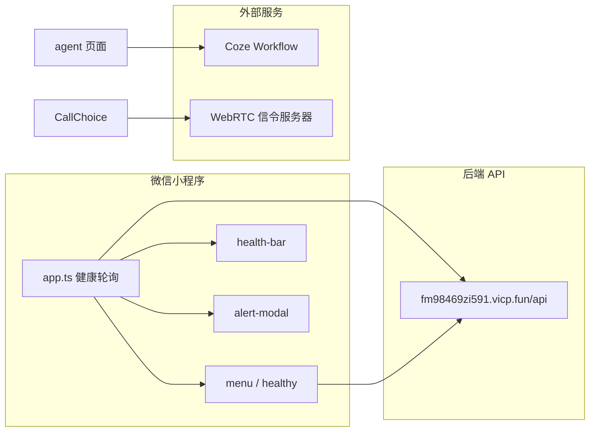

# WALL-E 微信小程序

面向 **WALL-E 陪伴/监护机器人** 的微信小程序端，用于远程查看体征、管理日程提醒、视频通话、遥控机器人，以及调试 AI 陪伴能力。本目录为 [WALL-E](https://github.com/zcx-666666-zcx/WALL-E) 仓库的 **`WeChatProgramme`** 分支。

---

## 项目简介

WALL-E 是一套面向居家陪护场景的机器人系统。微信小程序作为 **家属/监护人的移动端控制台**，与后端 API、机器人硬件、Coze AI 工作流协同工作，实现「监测 → 告警 → 联系 → 遥控」的闭环。

| 角色 | 说明 |
|------|------|
| 被监护人 | 通过机器人传感器采集心率、体温、湿度、呼吸、跌倒等数据 |
| 家属用户 | 使用小程序登录后，查看健康数据、设置提醒、发起通话与遥控 |
| 机器人端 | 执行提醒播报、移动/云台、摄像头与星闪等硬件能力 |

---

## 技术栈与框架特点

| 类别 | 选型 / 说明 |
|------|-------------|
| 平台 | 微信小程序（基础库 `3.12.1`） |
| 语言 | **TypeScript + JavaScript** 混用（`app.ts`、组件与部分页面为 TS，登录/注册等为 JS） |
| 渲染 | **glass-easel** 组件框架 + **Skyline** 渲染（`project.config.json`） |
| 加载 | `lazyCodeLoading: requiredComponents` 按需注入组件 |
| 类型 | `miniprogram-api-typings` + `typings/` 下微信 API 声明 |
| 网络 | 统一封装 `utils/request.js`，对接自建后端 |
| 状态 | `App.globalData` 全局状态 + `eventBus` 发布订阅 |
| AI | [Coze](https://www.coze.cn/) Workflow API（对话与人设） |
| 通话 | WebRTC + WebSocket 信令（`CallChoice` 页面，需本地信令服务） |

**架构特点：**

- **全局健康轮询**：`app.ts` 启动后每 2 秒拉取设备体征并执行阈值检测，同步到 `globalData` 与 `eventBus`。
- **可复用告警 UI**：`health-bar`（顶栏体征条）与 `alert-modal`（异常弹窗）在菜单、通话等页面复用。
- **页面职责清晰**：认证 → 主菜单 → 各功能子页；底部 Tab 覆盖「我的 / 设置 / 说明」。
- **混合工程**：新页面倾向 TS，历史页面保留 JS，便于渐进迁移。

---

## 功能模块

### 1. 用户与认证

| 页面 | 路径 | 功能 |
|------|------|------|
| 首页 | `pages/index` | 产品介绍与入口导航 |
| 登录 | `pages/login` | 用户名密码登录，写入 `globalData.USERNAME` |
| 注册 | `pages/registion` | 注册（含手机号校验），对接 `/api/users/register` |

### 2. 主控制台

| 页面 | 路径 | 功能 |
|------|------|------|
| 菜单 | `pages/menu` | 核心功能入口；集成 `health-bar`、`alert-modal` |
| 我的 | `pages/user` | 用户信息、联系人、事件、指令记录、星闪入口 |
| 设置 | `pages/set` | 语音控制、事件呼叫、AI、机器人摄像头等开关 |
| 说明 | `pages/info` | 各功能图文说明（可折叠） |

### 3. 健康监测

| 页面 / 组件 | 说明 |
|-------------|------|
| `pages/healthy` | 心率、湿度、呼吸、体温、跌倒状态；支持多设备切换与 min/max 统计 |
| `utils/check.js` | 阈值规则：跌倒、心率、湿度、呼吸、体温异常文案 |
| `components/health-bar` | 顶栏实时体征与状态色（normal / warn / danger） |
| `components/alert-modal` | 异常弹窗，支持稍后提醒、查看详情 |

后端接口示例（`deviceId` 默认为 `kCx33ym0Dt`，可在 `app.globalData.DEVICEID` 修改）：

- `GET /api/healthy/getRate/{deviceId}`
- `GET /api/healthy/getHumidity/{deviceId}`
- `GET /api/healthy/getBreathe/{deviceId}`
- `GET /api/healthy/getTemperature/{deviceId}`
- `GET /api/healthy/getFall/{deviceId}`

### 4. 事件提醒

| 页面 | 功能 |
|------|------|
| `pages/elementList` | 按用户 ID 拉取事件列表，支持删除 |
| `pages/elementUse` | 新建/编辑事件：名称、日期时间、重复周期（1–365 天）、优先级、关联设备 |

### 5. 视频通话（远程监护）

| 页面 | 功能 |
|------|------|
| `pages/CallChoice` | WebRTC 房间加入、发起通话、双画面（远端 + 本地画中画）、信令日志 |

需在 `CallChoice.ts` 中配置可用的 **信令服务器地址**（默认示例为局域网地址）。小程序已声明摄像头、录音权限（`app.json` → `permission`）。

### 6. 远程遥控

| 页面 | 功能 |
|------|------|
| `pages/drive` | 六向控制 UI：左转/右转、前进/后退、抬头/低头；`start()` 内预留实际控制逻辑 |

### 7. AI 陪伴调试

| 页面 | 功能 |
|------|------|
| `pages/agent` | 与 Coze Workflow 对话；提交/获取 AI「人设」；聊天记录清屏 |

> **安全提示**：当前 Coze `Bearer Token` 写在页面源码中，上线前请迁至服务端或云函数，勿提交真实密钥到公开仓库。

### 8. 设备与连接

| 页面 | 功能 |
|------|------|
| `pages/machine` | 已连接设备列表（`connected_devices` 本地缓存） |
| `pages/Star` | 星闪（NearLink）设备扫描与管理（`star_devices`） |
| `pages/contact` | 紧急联系人（本地 `emergency_contacts`，支持一键拨号） |
| `pages/commandList` | 自定义指令历史（`command_history`） |

---

## 目录结构

```
WALL-E-WeChatProgramme/
├── miniprogram/
│   ├── app.ts / app.json / app.wxss    # 小程序入口与全局样式
│   ├── components/
│   │   ├── health-bar/                 # 顶栏健康状态条
│   │   └── alert-modal/                # 健康异常弹窗
│   ├── pages/                          # 业务页面（见上文功能表）
│   └── utils/
│       ├── request.js                  # HTTP 封装（baseURL）
│       ├── getData.js                  # 健康数据拉取
│       ├── check.js                    # 体征阈值检测
│       └── eventBus.js                 # 简单事件总线
├── typings/                            # 微信 API TypeScript 类型
├── project.config.json                 # 开发者工具工程配置
├── tsconfig.json
├── package.json
└── README.md
```

---

## 数据流示意



---

## 快速开始

### 环境要求

- [微信开发者工具](https://developers.weixin.qq.com/miniprogram/dev/devtools/download.html)（建议最新稳定版）
- Node.js（可选，用于安装 `miniprogram-api-typings`）

### 本地运行

1. 克隆仓库并切换到本分支：

   ```bash
   git clone -b WeChatProgramme git@github.com:zcx-666666-zcx/WALL-E.git
   cd WALL-E
   ```

2. 用微信开发者工具打开项目根目录（含 `project.config.json` 的目录）。

3. 在 `project.config.json` 中填写你自己的 **AppID**（或使用测试号）。

4. （可选）安装类型依赖：

   ```bash
   npm install
   ```

5. 编译并预览：工具栏 → 编译 → 真机调试/预览。

### 配置说明

| 配置项 | 位置 | 说明 |
|--------|------|------|
| 后端地址 | `miniprogram/utils/request.js` → `baseURL` | 默认 `https://fm98469zi591.vicp.fun/api` |
| 设备 ID | `miniprogram/app.ts` → `globalData.DEVICEID` | 健康数据绑定的设备标识 |
| 静态资源 | 各页面 `image_ip` 等 | 指向同一域名的图片 CDN |
| 信令服务 | `pages/CallChoice/CallChoice.ts` → `SERVER_URL` | WebRTC 信令 WebSocket 地址 |
| Coze | `pages/agent/agent.ts` | Workflow ID、Token（建议改为服务端代理） |

登录、注册、事件等接口均走上述 `baseURL`，需保证后端服务可达且小程序 **request 合法域名** 已在微信公众平台配置。

---

## 全局状态（`globalData`）

`app.ts` 中维护的常用字段：

| 字段 | 含义 |
|------|------|
| `USERNAME` / `usreId` | 当前登录用户 |
| `DEVICEID` | 当前监测设备 ID |
| `RATE` / `HUMIDITY` / `BREATHE` / `TEMPERATURE` / `FALL` | 最新体征 |
| `HEALTH_ALERT_TEXT` / `HEALTH_ALERT_TYPE` | 告警文案与是否异常 |
| `can_speak_control` 等 | 功能开关（与设置页同步） |

---

## 页面路由一览

`app.json` 注册的首页为 `pages/index/index`，完整页面列表：

`index` → `login` / `registion` → `menu` →  
`healthy` · `elementList` / `elementUse` · `CallChoice` · `drive` · `machine` · `agent` ·  
`user` · `set` · `info` · `contact` · `commandList` · `Star`

---

## 开发说明

- **新增页面**：在 `miniprogram/pages/` 下创建四件套（`.json` / `.ts` / `.wxml` / `.wxss`），并在 `app.json` 的 `pages` 数组中注册。
- **新增组件**：放在 `miniprogram/components/`，在页面 `.json` 中 `usingComponents` 引用。
- **健康相关逻辑**：优先复用 `getData.js`、`check.js` 与全局轮询，避免多处重复定时器。
- **提交前**：检查 `project.private.config.json` 是否应忽略（含本地 AppID 等），勿将 Token、内网穿透密钥提交到公开分支。

---

## 相关仓库

- 主仓库：[zcx-666666-zcx/WALL-E](https://github.com/zcx-666666-zcx/WALL-E)
- 本分支：[WeChatProgramme](https://github.com/zcx-666666-zcx/WALL-E/tree/WeChatProgramme)

---

## 许可证

请以主仓库 WALL-E 的许可证说明为准；若主仓库未声明，使用前请联系仓库维护者。
