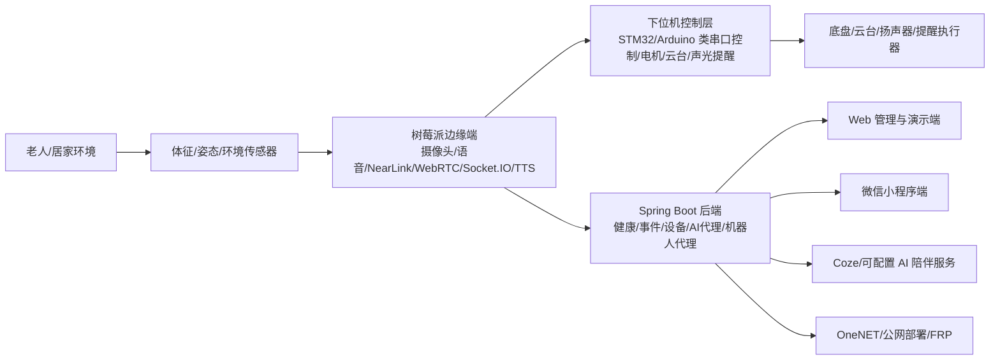

# 03-西门子杯总体参赛策略

## 推荐参赛定位

建议将项目定位为：

> 面向居家智慧养老场景的多模态适老化智能陪护机器人研发与制造方案。

这个定位能同时覆盖评分表的几个核心点：

- 产品创意：移动式主动陪护 + 情感交互 + 健康安全闭环。
- 技术方案：机器人本体 + 树莓派边缘端 + Spring Boot 后端 + Web/小程序 + AI 服务。
- 原型机：有实物、有 Web 演示、有树莓派端、有兜底模拟器。
- 制造可行性：通过可编辑三维模型、BOM、装配流程、测试表和质控策略补强。
- 市场策略：智慧养老与居家安全需求明确，可对接社区/养老机构。
- ESG：节能、隐私、普惠养老、可维修、可持续服务。

已确认口径：自由探索方向不强制使用西门子控制器。材料中不再把 PLC/TIA/西门子控制层作为合规前提；如果后续有相关硬件资源，可作为工业自动化增强或生产测试方案补充。

## 项目名称建议

提交版名称建议使用：

> 星护安庭：星闪赋能生成式 AI 多模态适老化陪护机器人

备选精简名称：

> 星护安庭：多模态适老化智能陪护机器人

说明：

- “星护安庭”延续既有材料识别度。
- “星闪赋能”和“生成式 AI”来自既有项目主线，但正式材料中的指标要以当前样机测试证据为准。
- 如果现场无法稳定验证星闪链路，可以把“星闪”放在核心技术页，而不是放在标题最前面。

## 推荐总体架构

## 工程化增强方向

### 必做方向：现有链路证据化

目标不是重写控制系统，而是把已有系统讲清楚、测清楚、录清楚。

- 控制链路：Web 遥控 -> 后端机器人代理 -> 树莓派 Socket.IO -> 下位机串口 -> 底盘/云台执行。
- 健康链路：NearLink/传感器或模拟器 -> 树莓派解析 -> 后端健康接口 -> Web/小程序展示。
- 告警链路：跌倒/异常状态 -> 后端记录 -> Web/小程序提示 -> 机器人语音/声光提醒。
- 视频链路：树莓派摄像头 -> WebRTC -> Web 端远程监护。
- 事件链路：Web 创建提醒 -> 后端存储 -> 树莓派轮询 -> 到点播报。

### 必做方向：制造资料补齐

- 三维模型源文件目录：`/Users/zhangchenxi/Desktop/西门子规划/可编辑瓦力`。
- 重点提交文件：`Wall-e_Assembly_NotForPrinting.STEP`、`Wall-e_Assembly_NotForPrinting2.SLDASM`、`Body Assembly.SLDASM`、`Head Assembly.SLDASM`、`Neck Assembly.SLDASM`、`TankTracks.SLDASM`。
- 需要补充：模型截图、爆炸图、装配说明、BOM、关键零件说明、制造方式说明、质检点。

### 可选方向：西门子工业化补充

如果团队能方便借到设备，可以把西门子产品放在“生产测试、工业网关、安全状态监测、自动化产线验证”等位置，但不作为自由探索方向的硬性要求。

可选呈现方式：

- 生产测试夹具：用于批量检测电机、传感器、报警输出。
- 工业网关：用于把样机运行日志接入工业数据看板。
- 安全联锁演示：用于展示急停、失联停车、故障码输出。

没有西门子硬件时，正式方案不写具体型号和程序截图，避免被专家追问无法验证。

## 5 分钟原型机演示主线

目标：让评委在 5 分钟内看到“问题发现 - 数据采集 - 边缘处理 - 云端触达 - 子女处置 - 机器人响应”的闭环。

建议演示顺序：

1. **30 秒：样机启动与架构指认**
   - 摄像头对准原型机，展示树莓派、摄像头、传感器、底盘/云台、Web 页面。
   - Web 端登录，进入健康/遥控/视频页面。

2. **60 秒：健康与星闪/体征数据上报**
   - Web 健康页展示心率、呼吸、温湿度、跌倒状态刷新。
   - 若真实星闪不稳，使用 `hardware-demo health --mode normal` 兜底，但材料中不能把模拟当真实测试。

3. **60 秒：异常/跌倒触发与报警闭环**
   - 触发跌倒或异常体征。
   - Web/小程序出现异常状态，机器人声光/语音提醒，后端记录数据。

4. **60 秒：远程视频与巡视**
   - WebRTC 页面加入房间，请求监视，看到机器人画面。
   - 说明隐私授权逻辑：默认不开启，异常或授权后才打开。

5. **60 秒：远程遥控与安全停车**
   - Web 遥控下发前进/转向/停止。
   - 展示机器人执行、停止指令、通信超时或人工停止后的安全状态。

6. **30 秒：生活事件提醒/AI 陪伴补充**
   - 事件到点播报，或 AI 按老人偏好回答一句。
   - 不要让 AI 演示占太久，避免网络不稳。

## 5 分钟方案陈述主线

PPT 不要做成创业路演，要按评分项讲。

1. 痛点与产品创意：独居老人安全、陪伴、远程照护断层。
2. 产品方案：移动式主动陪护机器人，形成监测、报警、通话、遥控、提醒、陪伴闭环。
3. 技术方案：机器人本体 + 树莓派边缘端 + 后端云服务 + Web/小程序 + AI。
4. 原型机验证：测试表、现场功能、关键指标、兜底策略。
5. 制造可行性：三维模型、BOM、装配、质控、可维护。
6. 市场与 ESG：场景、价格、渠道、应用证明、隐私、节能、风险管理。

## 技术口径建议

| 原口径 | 风险 | 建议口径 |
| --- | --- | --- |
| “国内首批”“零丢包零延迟” | 难证明，容易被追问 | “基于星闪低时延、高可靠特性设计家庭感知链路，并通过样机测试记录验证” |
| “WebRTC <50ms” | 公网环境不稳定 | “局域网/典型网络下低延迟视频通话，现场以实测日志为准” |
| “LoRA/DPO 微调 Qwen-14B” | 当前代码主要是 Coze/外部 AI 服务 | “云端 AI 工作流与可配置人设；若有独立模型再补充微调证据” |
| “SLAM 主动抵近复核” | 仓库未看到完整 SLAM 实现 | “规划升级功能；当前原型机展示远程巡视、云台复核或定点移动复核” |
| “小程序远程遥控” | 小程序 `drive.ts` 控制逻辑预留 | “Web 端远程遥控为主演示，小程序展示健康/事件/AI 等移动端能力” |
