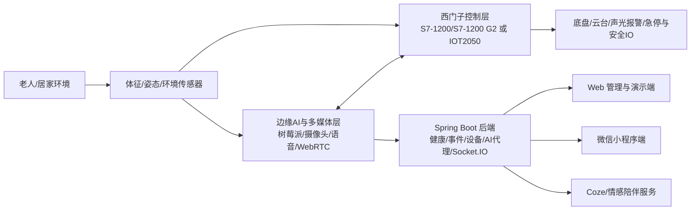

# 03-西门子杯总体参赛策略

## 推荐参赛定位

建议将项目从“适老化陪护机器人”升级表述为：

> 面向居家智慧养老场景的西门子控制赋能型智能陪护机器人研发与制造方案。

这个定位能同时覆盖评分表的几个核心点：

- 产品创意：移动式主动陪护 + 情感交互 + 健康安全闭环。
- 技术方案：端-边-云架构 + 西门子控制层 + 星闪/多传感 + 视频/AI/健康数据。
- 原型机：有实物、有 Web 演示、有树莓派端、有兜底模拟器。
- 制造可行性：通过 PLC 控制、模块化装配、三维模型、BOM、质控流程补强。
- 市场策略：智慧养老与居家安全需求明确，可对接社区/养老机构。
- ESG：节能、隐私、普惠养老、可维修、可持续服务。

## 项目名称建议

提交版名称建议使用：

> 星护安庭：西门子控制赋能的多模态适老化智能陪护机器人

说明：

- “星护安庭”延续既有材料识别度。
- “西门子控制赋能”直面比赛要求。
- “多模态适老化智能陪护机器人”保留核心价值。

如果担心“星闪”技术在现场无法完全验证，标题里不把“星闪”放在最前面，把它作为通信创新之一写入技术方案。

## 推荐总体架构

## 西门子化改造推荐

### 首选方案：S7-1200/S7-1200 G2 做控制核心

用途：

- 运动控制使能：前进、后退、转向、停止、速度档位。
- 云台/报警 IO：舵机或继电器、状态灯、蜂鸣器。
- 安全联锁：急停、低电量保护、跌倒报警输出、通信超时停车。
- 状态采集：电源状态、运行模式、故障码。

树莓派保留：

- 摄像头采集、WebRTC、AI 对话、NearLink 数据解析、HTTP/Socket.IO 与后端连接。
- 向 PLC 下发高层命令：`MOVE_FORWARD`、`TURN_LEFT`、`STOP`、`ALARM_ON` 等。

优点：

- 最符合“控制器必须在西门子产品中选型”。
- 方便做 TIA Portal 程序截图、梯形图、IO 表、状态机图，技术方案分更稳。
- 更容易向制造工程、品质控制、工业可靠性方向叙述。

风险：

- 需要硬件、供电、IO 转接、电机驱动接口、TIA Portal 环境。
- 需要至少做出一条可现场验证的 PLC 控制链路。

### 备选方案：SIMATIC IOT2050 做工业 IoT 网关

用途：

- 替代或并列树莓派作为工业网关，负责数据采集、协议转换、边缘预处理、云端转发。
- 保留 Python/Node/Linux 开发便利性。

依据：

- 西门子官方介绍 SIMATIC IOT2050 是智能 IoT 网关，可在现场采集、处理、转发数据，并连接 IT、生产和云；具备 Gbit LAN、USB、串口、Arduino 等接口。
- 官方链接：https://www.siemens.com/en-us/products/simatic-iot-gateways/change-me-9jaot93/

优点：

- 对当前树莓派代码迁移成本相对低。
- 能强化“工业 IoT、边缘计算、云连接”的智能制造叙事。

风险：

- 评分/规则说的是“控制器”，单用 IOT2050 可能不如 PLC 稳妥。
- 如果没有硬件实物，只写方案说服力不足。

### 不推荐方案：完全保留树莓派 + STM32，不加西门子控制器

原因：

- 规则明确限制控制器品牌。
- 即使项目本身功能多，也可能在合规和技术方案项失分。

## 5 分钟原型机演示主线

目标：让评委在 5 分钟内看到“问题发现 - 数据采集 - 边缘判断 - 西门子控制 - 云端触达 - 子女处置”的闭环。

建议演示顺序：

1. **30 秒：样机启动与架构指认**
   - 摄像头对准原型机，展示西门子控制器/控制层、树莓派、传感器、底盘/云台。
   - Web 端登录，进入健康/遥控/视频页面。

2. **60 秒：健康与星闪/体征数据上报**
   - Web 健康页展示心率、呼吸、温湿度、跌倒状态刷新。
   - 若真实星闪不稳，使用 `hardware-demo health --mode normal` 兜底，但材料中不能把模拟当真实测试。

3. **60 秒：异常/跌倒触发与报警闭环**
   - 触发跌倒或异常体征。
   - Web/小程序出现异常状态，机器人声光/语音提醒，后端记录数据。

4. **60 秒：远程视频与巡视**
   - WebRTC 页面加入房间，请求监视，看到机器人画面。
   - 说明隐私授权逻辑：默认不开启，异常或授权后才打开。

5. **60 秒：远程遥控 + 西门子控制链路**
   - Web 遥控下发前进/转向/停止。
   - 机器人执行或 PLC 输出状态灯/电机使能。
   - 强调通信超时自动停车、急停、安全状态。

6. **30 秒：生活事件提醒/AI 陪伴补充**
   - 事件到点播报，或 AI 按老人偏好回答一句。
   - 不要让 AI 演示占太久，避免网络不稳。

## 5 分钟方案陈述主线

PPT 不要做成创业路演，要按评分项讲。

1. 痛点与产品创意：独居老人安全、陪伴、远程照护断层。
2. 产品方案：移动式主动陪护机器人，形成监测、报警、通话、遥控、提醒、陪伴闭环。
3. 技术方案：西门子控制层 + 边缘 AI + 后端云服务 + Web/小程序。
4. 原型机验证：测试表、现场功能、关键指标、兜底策略。
5. 市场策略：居家/社区/机构三场景，价格、成本、渠道、竞品、合作证明。
6. 制造与 ESG：三维模型、BOM、装配、质控、隐私、节能、可维修。

## 技术口径建议

| 原口径 | 风险 | 建议口径 |
| --- | --- | --- |
| “国内首批”“零丢包零延迟” | 难证明，容易被追问 | “基于星闪低时延、高可靠特性设计家庭感知链路，并通过样机测试记录验证” |
| “WebRTC <50ms” | 公网环境不稳定 | “局域网/典型网络下低延迟视频通话，现场以实测日志为准” |
| “LoRA/DPO 微调 Qwen-14B” | 当前代码主要是 Coze/外部 AI 服务 | “云端 AI 工作流与可配置人设；若有独立模型再补充微调证据” |
| “SLAM 主动抵近复核” | 仓库未看到完整 SLAM 实现 | “规划升级功能；当前原型机展示远程巡视、云台复核或定点移动复核” |
| “小程序远程遥控” | 小程序 `drive.ts` 控制逻辑预留 | “Web 端远程遥控为主演示，小程序展示健康/事件/AI 等移动端能力” |

## 官方产品参考

- SIMATIC S7-1200 G2：西门子紧凑型 PLC，面向基础自动化，强调性能、通信、运动控制与可扩展性。官方链接：https://www.siemens.com/en-us/products/simatic/s7-1200-g2/
- SIMATIC IOT2050：西门子智能 IoT 网关，面向现场数据采集、处理、转发与 IT/云连接。官方链接：https://www.siemens.com/en-us/products/simatic-iot-gateways/change-me-9jaot93/
